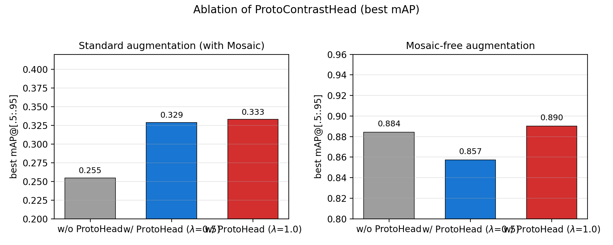

# Proto-RTDETR

**Proto-Contrast Learning for Industrial Defect Detection with RT-DETRv2.**

A lightweight prototype-based contrastive head (`ProtoContrastHead`) on top of [RT-DETRv2](https://github.com/lyuwenyu/RT-DETR) for sparse-annotation industrial surface-defect detection on the [VisA](https://github.com/amazon-science/spot-diff) benchmark.

---

## Paper

- **Title:** Proto-Contrast Learning for Industrial Defect Detection with RT-DETRv2
- **Authors:** [to be completed before merge]
- **Status:** **Submitted** (under review). *Not* published / accepted.

## Contributions

1. **ProtoContrastHead** — samples 256 pixels per image from the mid-level (stride-16) encoder feature map, assigns *image-level* pseudo-labels (defective vs. normal), and pulls pixels toward two *learnable* class prototypes with an InfoNCE objective. It is training-only and adds no computation at inference.
2. **Mosaic is harmful on VisA** — removing the default Mosaic augmentation raises mAP from 0.329 to 0.857 for this large-object dataset (train/test scale mismatch).
3. A thorough ablation study (head on/off, loss weight, denoising queries, augmentation, temperature).

## Method overview



`ProtoContrastHead` is attached to the encoder output (mid scale, stride 16). For each image it samples `S=256` pixels, assigns a single image-level label (defect = image has ≥1 GT box, else normal), projects features and two learnable prototypes through a 2-layer MLP (`256→256→128`, LayerNorm + ReLU), L2-normalizes both, and applies a softmax InfoNCE loss with temperature `τ=0.07`. The loss weight `λ` is applied once inside the head.

## Repository structure

```
.
├── train_proto_visa.py          # training / evaluation entry (--seed reproducible)
├── benchmark_infer.py           # inference FPS / params / VRAM benchmark
├── check_dataset.py             # dataset / annotation integrity check
├── configs/
│   ├── proto_rtdetrv2_r50vd_visa*.yml   # all paper experiment configs
│   ├── rtdetr/ rtdetrv2/        # upstream RT-DETR / RT-DETRv2 configs
│   └── dataset/                 # dataset configs (coco / visa)
├── src/
│   ├── nn/proto_contrast_head.py        # ProtoContrastHead (the proposed module)
│   ├── zoo/rtdetr/rtdetr.py             # RTDETR model: proto branch (256 sampling + image-level label)
│   ├── zoo/rtdetr/                      # base RT-DETRv2 (encoder / decoder / matcher / criterion)
│   ├── solver/                          # training / evaluation engine
│   └── data/                            # COCO dataset + transforms
├── tools/visa_csv2coco.py      # VisA mask → COCO bbox conversion
├── paper/                      # paper source + figure generation
├── docs/                       # alignment / dataset protocol / reproducibility / limitations
└── results/                    # paper numbers traceability
```

## Installation

```bash
pip install -r requirements.txt
```

Reference environment (Windows, single 8 GB GPU, conda env `fedsem`):

```powershell
D:\conda_envs\fedsem\python.exe <script> <args>
```

Dependencies (`requirements.txt`): `torch>=2.0.1`, `torchvision>=0.15.2`, `faster-coco-eval>=1.6.6`, `PyYAML`, `tensorboard`, `scipy`, `pycocotools`, `onnx`, `onnxruntime-gpu`.

> **Must keep `use_amp: False`** (top-level config). RT-DETRv2's decoder uses `torch.inf` as an anchor sentinel; under FP16 this can produce NaN and crash the matcher assertion. The model is small enough that FP32 has no memory cost.

## Data preparation

**Download VisA** (not included in this repo):

- Direct download: `https://amazon-visual-anomaly.s3.us-west-2.amazonaws.com/VisA_20220922.tar`
- Official repo / docs: <https://github.com/amazon-science/spot-diff>
- AWS Open Data registry: <https://registry.opendata.aws/visa/>
- License: CC BY 4.0

VisA provides masks (not boxes). Convert masks → COCO boxes:

```powershell
python tools/visa_csv2coco.py
```

- 12 object types are mapped to a single `defect` class (`category_id=1`).
- Each mask is converted to tight bounding boxes via connected-component labeling (`scipy.ndimage.label`).
- Split: authors' own **80/20 random split (seed 42, stratified by object)**, *not* VisA's official split. See `docs/dataset_protocol.md`.

> **VisA images and pretrained weights are NOT included in this repository.** Download VisA from the URL above, and download the RT-DETRv2 COCO weights from the upstream repository (see below).

## Training

Run from the repository root (deterministic with `--seed 42`):

```powershell
python train_proto_visa.py -c configs/proto_rtdetrv2_r50vd_visa.yml --seed 42
```

Reproduce the paper's main/ablation results:

| Paper result | config | best mAP |
|---|---|---|
| RT-DETRv2 (default aug.) | `configs/proto_rtdetrv2_r50vd_visa_abl_wo_proto.yml` | 0.255 |
| + ProtoContrastHead λ=0.5 (default aug.) | `configs/proto_rtdetrv2_r50vd_visa.yml` | 0.329 |
| + ProtoContrastHead λ=1.0 (default aug.) | `configs/proto_rtdetrv2_r50vd_visa_abl_lw1.yml` | 0.333 |
| RT-DETRv2 (no Mosaic) | `configs/proto_rtdetrv2_r50vd_visa_abl2_wo_proto.yml` | 0.884 |
| + ProtoContrastHead λ=0.5 (no Mosaic) | `configs/proto_rtdetrv2_r50vd_visa_abl_no_mosaic.yml` | 0.857 |
| **+ ProtoContrastHead λ=1.0 (no Mosaic, final)** | `configs/proto_rtdetrv2_r50vd_visa_abl2_lw1.yml` | **0.890** |
| denoising=100 | `configs/proto_rtdetrv2_r50vd_visa_abl_dn100.yml` | 0.329 |

CLI (from `train_proto_visa.py`, not guessed):

```
--config/-c  --resume/-r  --test-only  --amp  --seed (default 42)
```

Each 16-epoch run takes ~9.5 h on a single 8 GB GPU (batch 2, `num_workers=0`, 640×640).

## Evaluation

```powershell
# evaluate a trained checkpoint on the validation split
python train_proto_visa.py -c configs/proto_rtdetrv2_r50vd_visa_abl2_lw1.yml --resume output/<run>/best.pth --test-only
```

Metrics: standard COCO `mAP@[.5:.95]`, `AP@.50`, `AP@.75`, `AR@100` on the validation split. Per-epoch metrics are written to `output/<run>/log.txt`.

## Model weights

- **Pretrained RT-DETRv2 COCO weights** (`rtdetrv2_r50vd_6x_coco_ema.pth`): download from the [upstream RT-DETR repository](https://github.com/lyuwenyu/RT-DETR). Not redistributed here.
- **Trained checkpoints / logs**: not included in this repository (large). They can be made available on request or via a release asset (with SHA256) if needed.

## Known limitations

See [`docs/known_limitations.md`](docs/known_limitations.md). Highlights:

- The mask→box conversion does not filter tiny noise fragments; no genuine small objects exist in VisA (small/medium AP is `-1.0` by definition).
- External SOTA baselines are cited from literature and were **not re-run locally**.
- Image-level pseudo-labels are coarse (a defect image may contain mostly normal pixels, yet all its sampled pixels are pushed to the defect prototype).
- Statistical power is limited by the small validation set (239 instances).
- FPS / parameter / VRAM figures come from the authors' machine and are not independently re-verified here.

## Citation

```bibtex
@misc{proto_rtdetr,
  title = {Proto-Contrast Learning for Industrial Defect Detection with RT-DETRv2},
  author = {[to be completed before merge]},
  year = {2026},
  note = {Submitted, under review}
}
```

See [`CITATION.cff`](CITATION.cff).

## Acknowledgments & license

- Built on [RT-DETR / RT-DETRv2](https://github.com/lyuwenyu/RT-DETR) by Lyuwenyu (Apache-2.0). The base detector code under `src/` is derived from the upstream implementation and is licensed under **Apache-2.0** (see [`LICENSE`](LICENSE)).
- `ProtoContrastHead` and the VisA experiment pipeline are the authors' additions.
- Datasets: [VisA](https://github.com/amazon-science/spot-diff) (Amazon Science), [MVTec AD](https://www.mvtec.com/company/research/datasets/mvtec-ad) (referenced in the paper).
