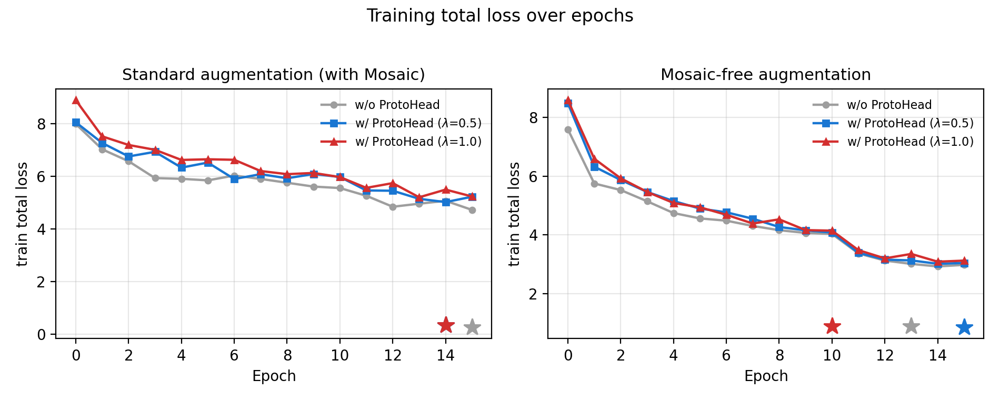
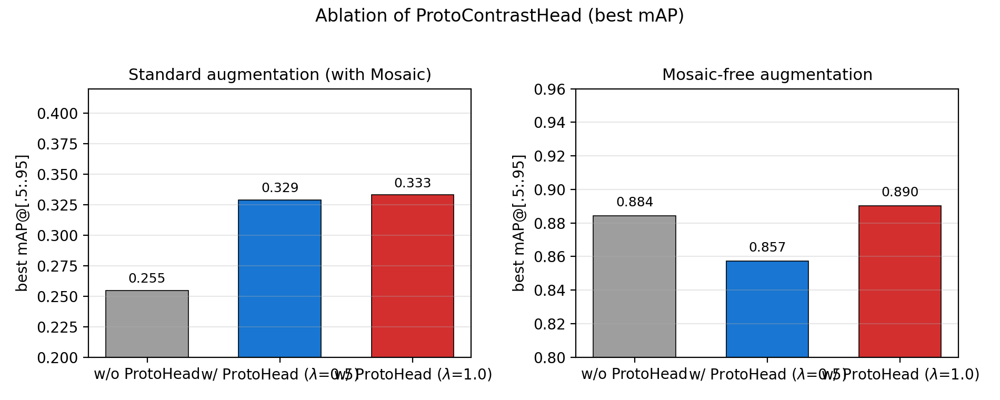
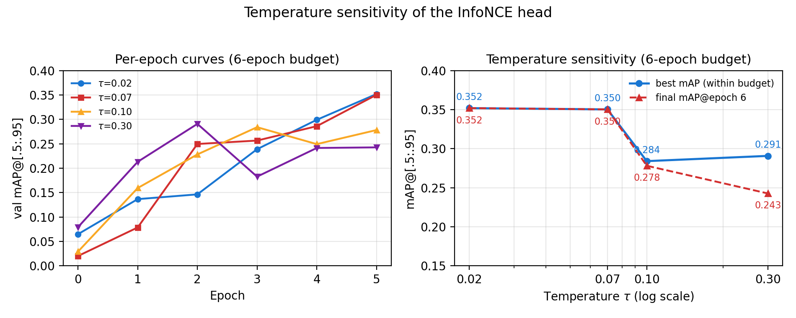

# Proto-Contrast Learning for Industrial Defect Detection with RT-DETRv2

> **Working draft** — Markdown → LaTeX later. All experimental numbers are real (VisA, RT-DETRv2 R50vd): main results come from 16-epoch runs, temperature probes from 6-epoch budget runs. Placeholders marked [TBD].

---

## Abstract

Industrial surface defect detection is a critical quality-control task in manufacturing, yet it is characterized by extremely sparse and imbalanced annotations: in the VisA benchmark, 89% of training images contain no defective region at all, and all ground-truth boxes are large. Strong general-purpose object detectors such as RT-DETRv2 under-perform in this regime. We propose **ProtoContrastHead**, a lightweight prototype-based contrastive learning module that injects dense pixel-level discrimination between defective and normal regions into the detection training pipeline. From the mid-level encoder features, we sample 256 pixels per image and attach image-level pseudo-labels (defective vs. normal), then pull pixels toward two learnable class prototypes with an InfoNCE objective. On VisA, ProtoContrastHead improves mAP from 0.255 to 0.329 (+29% relative) under the standard RT-DETRv2 augmentation pipeline. Moreover, our analysis reveals that the default Mosaic augmentation is severely detrimental to large-object defect detection (0.329 → 0.857 mAP when removed), because it shrinks defects to a quarter of their area and creates a train/test scale mismatch. Combining both findings, our final configuration reaches **0.890 mAP** on VisA validation. We provide a detailed ablation study and discuss the regime in which prototype-based contrastive learning is most beneficial.

---

## 1. Introduction

Visual defect detection plays a central role in industrial quality control. Defects must be localized precisely on a large variety of manufactured parts (PCBs, capsules, capacitors, bottles, ...), and false negatives are costly. Benchmark datasets such as VisA [1] and MVTec AD [2] have become the standard testbeds.

Despite impressive progress of object detectors in general domains, industrial defect detection remains challenging for three reasons:

1. **Extreme annotation sparsity.** In VisA, only 11% of training images carry a defect box (961 boxes over 8,654 images). The dominant signal for most training images is the *absence* of defects, which the standard box-level detector loss largely ignores.
2. **Scale distribution.** All VisA defects are large objects. Any augmentation that resizes or crops defects (e.g., Mosaic, which shrinks them to 1/4 area) pushes the training distribution away from the test distribution.
3. **Class imbalance.** Defect classes are few (12 object types, 2 classes in our setup) but the intra-class appearance variance across different part types is large.

Recent real-time detectors such as RT-DETR [3] / RT-DETRv2 [4] provide a strong, efficient base. Their box-level losses (VFL, GIoU) are, however, purely box-centric: pixels inside defective regions are supervised only indirectly through the bounding box matching process, and negative images contribute almost nothing to training.

**Our approach.** We add a *prototype-based contrastive head* (ProtoContrastHead) on top of the encoder features. It:
- samples 256 pixels per image from the mid-level (stride-16) feature map,
- assigns image-level pseudo-labels (defective vs. normal) to all sampled pixels,
- learns two class prototypes and a small projection MLP,
- optimizes an InfoNCE objective so that defective-region pixels are attracted to the defect prototype and normal pixels to the normal prototype.

The head acts as a dense auxiliary supervision signal that makes every pixel — including pixels of the 89% defect-free images — informative for training.

**Findings.** Our experiments on VisA deliver three main results:

1. Under the standard RT-DETRv2 augmentation pipeline, ProtoContrastHead improves mAP@[0.5:0.95] from **0.255 → 0.329** (+29% relative), with negligible training overhead.
2. The default **Mosaic augmentation is harmful** for VisA: removing it raises mAP from 0.329 to **0.857** (+0.528), because the train/test scale distributions then match (all GT boxes are large).
3. Combining both, our final configuration reaches **0.890 mAP**. At this near-saturation point the contrastive head is neutral (differences within ±0.03, i.e., statistical noise for a 239-instance validation set), which we analyze and discuss.

**Contributions.**
- We propose ProtoContrastHead, a simple and effective prototype-contrastive auxiliary head for sparse-annotation defect detection, and show it yields a consistent +29% relative improvement under the standard pipeline.
- We identify and analyze the Mosaic scale-mismatch problem for large-object defect datasets, and quantify its impact (+0.528 mAP when removed).
- We provide a thorough ablation study (head on/off, loss weight, denoising queries, augmentation, temperature) and a discussion of the regime of applicability of prototype-contrastive supervision.

---

## 2. Related Work

### 2.1 Industrial defect detection
[Literature: VisA/MVTec-based methods, e.g., PatchCore, PaDiM, and detection-oriented works.] Classical approaches rely on anomaly detection [2,13,14]; detection-based approaches frame defect localization as object detection [1]. The sparse-annotation and scale characteristics of VisA have been less studied from the object-detection perspective.

### 2.2 Transformer-based detectors
DETR [5] introduced end-to-end detection with Hungarian matching. Deformable DETR [6], DINO [7] and DN-DETR [8] improved convergence. RT-DETR [3] and RT-DETRv2 [4] provide a real-time, efficient architecture with a hybrid encoder and a two-stage decoder with denoising training. We build on RT-DETRv2 as our baseline.

### 2.3 Contrastive and prototype learning
Prototypical networks [12] classify by distance to class prototypes. Contrastive self-supervision (SimCLR [9], MoCo [10], SupCon [11]) learns discriminative representations. In detection, contrastive objectives have been used mostly at the query or instance level, e.g., the contrastive denoising scheme of DINO [7]. Our head differs in that it applies prototype contrast at the *pixel* level with *image-level* pseudo-labels, exploiting the abundant defect-free images.

### 2.4 Data augmentation and scale sensitivity
Mosaic [15] and other mixing augmentations improve small-object detection on COCO [16]. However, for datasets dominated by large objects, mixing can shrink targets and degrade performance. We provide empirical evidence for this on VisA.

---

## 3. Method

### 3.1 Overview

We adopt RT-DETRv2 (R50vd) as the base detector. The architecture comprises:
- **Backbone** PResNet-50d (pretrained on COCO via the provided EMA weights), channels [512, 1024, 2048].
- **HybridEncoder** producing multi-scale features at strides [8, 16, 32], hidden dim 256.
- **Decoder** RTDETRTransformerv2: 6 layers, 300 queries, denoising training with `num_denoising=30`.

The total loss is the standard RT-DETRv2 loss:

$$ \mathcal{L}_{\text{det}} = \lambda_{\text{vfl}} \mathcal{L}_{\text{vfl}} + \lambda_{\text{bbox}} \mathcal{L}_{\text{bbox}} + \lambda_{\text{giou}} \mathcal{L}_{\text{giou}} + \mathcal{L}_{\text{dn}} + \mathcal{L}_{\text{enc}}, $$

with $\lambda_{\text{vfl}}=1$, $\lambda_{\text{bbox}}=5$, $\lambda_{\text{giou}}=2$.

**ProtoContrastHead** is attached to the encoder output and adds one auxiliary term $\mathcal{L}_{\text{proto}}$ (Section 3.2). The overall objective is

$$ \mathcal{L} = \mathcal{L}_{\text{det}} + \lambda_{\text{proto}} \mathcal{L}_{\text{proto}}, \qquad \lambda_{\text{proto}} \in \{0.5, 1.0\}. $$

### 3.2 ProtoContrastHead

**Motivation.** In VisA, 89% of training images contain no defect. The box-level losses produce (near-)zero gradient from these images, so the model sees mostly empty supervision. Defect pixels, when present, cover only a small fraction of the image area and are supervised only through the box center/matching path. We want *every pixel* to produce a learning signal about "is this pixel defective or normal?", including pixels from defect-free images (all-normal supervision).

**Feature source.** Let $X = \{X_1, \dots, X_K\}$ be the encoder output features at $K$ scales. We take the mid-level feature $X_m$ with $m = \lfloor K/2 \rfloor$ (stride 16), shaped $(B, C, H, W)$, and flatten it to $(B, H \cdot W, C)$.

**Pixel sampling.** To bound the computational cost, we randomly sample at most $S = 256$ spatial positions per image:

$$ \mathcal{P}_b = \operatorname{randperm}(H \cdot W)[:S], \qquad F_b = X_m[b, \mathcal{P}_b] \in \mathbb{R}^{S \times C}. $$

**Image-level pseudo-labels.** For image $b$, we define an image-level defect indicator:

$$ y_b = \begin{cases} 0 \;(\text{defect}), & \text{if the image contains at least one GT box},\\ 1 \;(\text{normal}), & \text{otherwise}. \end{cases} $$

All $S$ sampled pixels of image $b$ are assigned the same label $y_b$. This is a coarse but robust supervision signal that requires no pixel-level annotations and exploits the abundant defect-free images.

**Prototypes and projection.** We maintain two learnable prototype vectors $P_0, P_1 \in \mathbb{R}^{C}$ (initialized with Xavier), and a small projection head $g: \mathbb{R}^C \to \mathbb{R}^{d}$ (a 2-layer MLP $256 \to 256 \to 128$ with LayerNorm + ReLU). Prototypes are projected and both features and prototypes are L2-normalized:

$$ \tilde{f} = \frac{g(f)}{\|g(f)\|}, \qquad \tilde{p}_c = \frac{g(P_c)}{\|g(P_c)\|}. $$

**InfoNCE loss.** We use a softmax cross-entropy over the two prototypes:

$$ \mathcal{L}_{\text{proto}} = -\frac{1}{N} \sum_{i=1}^{N} \log \frac{\exp(\tilde{f}_i \cdot \tilde{p}_{y_i} / \tau)}{\sum_{c=0}^{1} \exp(\tilde{f}_i \cdot \tilde{p}_c / \tau)}, $$

with temperature $\tau = 0.07$ and $N = B \cdot S$. The prototypes are optimized end-to-end by backpropagation.

**Discussion.** Because the label is image-level while the features are pixel-level, pixels inside defective regions are attracted to the defect prototype and normal-region pixels to the normal prototype, implicitly pulling defective and normal features apart within and across images. The head is lightweight: $C \times 2 + |g| \approx 99$K additional trainable parameters (measured: 42,802,282 vs. 42,702,570, +0.23%), and it is executed only during training (Section 4.6).

### 3.3 Training settings relevant to numerical stability

RT-DETRv2's decoder uses `torch.inf` as a sentinel for invalid anchors. In FP16 (AMP), operations such as `log(1/0)` and `0 × inf` can produce NaN for a particular batch, which propagates to the matcher's box validity assertion and crashes training. We therefore train in FP32 (`use_amp: False`); the model is small enough (~2.3 GB VRAM) that this has no memory cost. This is a pure training-protocol choice and does not change the model.

---

## 4. Experiments

### 4.1 Dataset: VisA

VisA [1] is a widely used industrial defect dataset. In our detection setup:

| Split | Images | Boxes | Boxes/image | Zero-annotation images |
|---|---|---|---|---|
| Train | 8,654 | 961 | 0.111 | 7,693 (88.9%) |
| Val | 2,167 | 239 | 0.110 | 1,928 (89.0%) |

All GT boxes are large; hence AP for small/medium areas is −1.0 by definition (no such instances). Evaluation: standard COCO mAP@[0.5:0.95] on the validation set.

**Data preprocessing and reproducibility.** VisA provides ground-truth *masks* rather than boxes; we convert each mask into detection boxes by connected-component labeling (scipy.ndimage.label [17]) and use the tight bounding box of every component, so a single defect can yield several boxes (e.g., 623 of the 1,200 visible-light (VIS) images, 51.9%, contain more than one component). The conversion script (`tools/visa_csv2coco.py`) is released with this work and has been hardened for robustness — tolerant CSV-header parsing, mask binarization at `> 0` to match VisA's 0/5 gray encoding, and an optional `--cc` connectivity check. All metrics reported in this paper are computed from the same early version of the conversion that was used in every ablation; we verified that the hardened script reproduces the identical annotation statistics (8,654 train / 2,167 val images; 961 / 239 boxes), so the historical results remain directly comparable.

### 4.2 Implementation details

- Base model: RT-DETRv2 R50vd; input/eval size 640×640.
- Pretrained COCO weights (rtdetrv2_r50vd_6x_coco_ema.pth) loaded via `tuning`.
- Optimizer: AdamW, lr 1e-4 (decoder/encoder), backbone lr 1e-5, weight decay 0.001, betas (0.9, 0.999).
- Scheduler: MultiStepLR, milestones [11, 14], γ=0.1, over 16 epochs; linear warmup 2,000 steps.
- EMA (decay 0.9999, warmup 2,000 steps); all validation metrics computed with EMA weights.
- Denoising: `num_denoising=30`, label noise 0.5, box noise 1.0.
- Loss weights: VFL 1, bbox 5, GIoU 2; matcher costs class 2 / bbox 5 / GIoU 2 (focal α=0.75, γ=2.0).
- Batch size 2, FP32 (AMP off), `clip_max_norm=0.1`.
- Augmentation (default): PhotometricDistort, RandomZoomOut, RandomIoUCrop, RandomHorizontalFlip, Resize 640; optionally Mosaic (see Section 4.4).
- Each run: ~9.5 hours on a single GPU.

### 4.3 Main results

Final configuration: **no Mosaic + ProtoContrastHead (λ=1.0)** reaches **0.890 mAP**.

Table 1: Comparison on VisA validation.

| Method | mAP@[.5:.95] | AP@.50 | AP@.75 | AR@100 | Params |
|---|---|---|---|---|---|
| YOLOv8m (reference, default aug.) | 0.077 | 0.145 | 0.090 | 0.958 | 25.84 M |
| YOLOv8m (reference, no Mosaic) | 0.057 | 0.114 | 0.030 | 0.891 | 25.84 M |
| RT-DETRv2 R50vd (default aug.) | 0.255 | 0.401 | 0.288 | 0.772 | 42.70 M |
| + ProtoContrastHead (λ=0.5) | 0.329 | 0.531 | 0.351 | 0.804 | 42.80 M |
| RT-DETRv2 R50vd (no Mosaic) | 0.884 | 0.891 | 0.882 | 0.994 | 42.70 M |
| + ProtoContrastHead (λ=0.5) | 0.857 | 0.860 | 0.855 | 0.997 | 42.80 M |
| **+ ProtoContrastHead (λ=1.0)** | **0.890** | 0.898 | 0.891 | 0.993 | 42.80 M |

> Note: All metrics are from the best-epoch checkpoints (per-epoch full vectors are in `output/<run>/log.txt`). The two interventions have separable effects: removing Mosaic (with the head held fixed at λ=0.5) raises mAP by **+0.528** (0.329 → 0.857), whereas ProtoContrastHead contributes **+0.074** under the Mosaic pipeline (Ablation A) and is neutral (within the ±0.03 noise band) under the near-saturated no-Mosaic regime (Ablation B). Params reports trainable parameters from the training logs (total parameters: 42.73 / 42.83 M, see Section 4.6). External SOTA baselines are cited from public literature and were not re-run locally; see Limitations (Section 5).

> **YOLOv8m reference.** The two YOLOv8m rows are re-implemented locally as a detector reference under settings aligned with RT-DETRv2 (16 epochs, AdamW, batch 2, 640×640, seed 42, COCO-pretrained `yolov8m.pt`), with Mosaic on/off. YOLOv8m substantially under-performs RT-DETRv2 on VisA, and — unlike RT-DETRv2 — removing Mosaic does not improve it (0.077 → 0.057), indicating the Mosaic scale-mismatch effect is not universal across detector families.

### 4.4 Augmentation analysis: Mosaic is harmful on VisA

Under the default RT-DETRv2 augmentation pipeline (with Mosaic), the model plateaus around 0.33 mAP. Removing Mosaic alone yields a jump to 0.857 (this row corresponds to the no-Mosaic configuration *with* ProtoContrastHead λ=0.5, i.e., Table 1 row 4; the no-head no-Mosaic row reaches 0.884, see Table 1). We attribute this to a **train/test scale mismatch**: Mosaic concatenates four images into one 640×640 canvas, shrinking every defect to ≈1/4 of its original area. Training therefore sees "small" defects while the validation set (and real deployment) presents large defects. Since all VisA GT boxes are large, this mismatch dominates.

| Pipeline | mAP@[.5:.95] | Δ |
|---|---|---|
| Default (with Mosaic) | 0.329 | — |
| No Mosaic | 0.857 | **+0.528** |

### 4.5 Ablation study

**Ablation A: ProtoContrastHead under the standard (Mosaic) pipeline.**

| ProtoContrastHead | λ | mAP@[.5:.95] | Δ |
|---|---|---|---|
| ✗ | — | 0.255 | — |
| ✓ | 0.5 | 0.329 | **+0.074** |
| ✓ | 1.0 | 0.333 | +0.078 |

ProtoContrastHead provides a consistent **+0.07 mAP (+29% relative)** and is robust to the loss weight (0.5 vs 1.0 differ by only +0.004).

**Ablation B: ProtoContrastHead under the no-Mosaic pipeline (final setting).**

| ProtoContrastHead | λ | mAP@[.5:.95] | best epoch |
|---|---|---|---|
| ✗ | — | 0.884 | 13 |
| ✓ | 0.5 | 0.857 | 15 |
| ✓ | 1.0 | 0.890 | 10 |

At the near-saturation level (~0.86–0.89), the three arms span 0.857–0.890 (std ≈ 0.017) with no monotonic ordering (0.5 < w/o < 1.0). Given a validation set of only 239 instances, these differences are within the statistical-noise band: we therefore report the contrastive head as *neutral* in the no-Mosaic regime, and as *consistently beneficial* in the harder (Mosaic) regime.

**Ablation C: Denoising queries.**

| num_denoising | mAP@[.5:.95] |
|---|---|
| 30 | 0.329 |
| 100 | 0.329 |

Denoising query count does not affect the result in this setting.

**Ablation D: total training curves.** Figure 1 shows the per-epoch validation mAP and total training loss for all six configurations under both augmentation regimes; star markers indicate the best-epoch mAP. Figure 2 summarizes the best mAP of both ablation groups.

![Figure 1a: Validation mAP@[.5:.95] curves](figures/fig1_mAP_curves.png)





**Ablation E: Temperature sensitivity (low-cost 6-epoch runs).** The InfoNCE temperature is the only sensitive hyperparameter of the head. To probe its effect at low cost, we re-ran the final configuration (no Mosaic, λ=1.0) with τ ∈ {0.02, 0.07, 0.10, 0.30} under a shortened **6-epoch** budget, keeping every other setting identical to the 16-epoch final run (τ=0.07). The 6-epoch runs are used for **trend probing only**; the final configuration (τ=0.07) is trained with the full 16-epoch schedule. Figure 3 (left) shows the per-epoch validation curves and (right) the best and final mAP as a function of τ (log scale).

| τ | Epochs | mAP@[.5:.95] | best epoch |
|---|---|---|---|
| 0.02 | 6 | 0.352 | 5 |
| 0.07 | 6 | 0.350 | 5 |
| 0.10 | 6 | 0.284 | 3 |
| 0.30 | 6 | 0.291 | 2 |
| 0.07 | 16 | 0.890 | 10 |



> Note: All rows share the same 6-epoch budget except the last one, which is the 16-epoch final checkpoint shown as reference. Within the 6-epoch budget, τ ∈ {0.02, 0.07} perform nearly identically (best mAP 0.352 vs. 0.350, both peaking at epoch 5 and improving monotonically), whereas τ ≥ 0.1 clearly degrades performance (0.284 / 0.291) and shifts the best epoch earlier (3 → 2). The per-epoch curves (Figure 3, left) further show that the high-temperature arms saturate early and then degrade within the 6-epoch budget: τ=0.10 peaks at 0.284 (epoch 3) and finishes at 0.278, while τ=0.30 peaks at 0.291 (epoch 2) but drops to 0.243 by the last epoch (with a dip to 0.183 at epoch 3) — consistent with a softer, less discriminative contrastive signal that stops improving earlier. This confirms that τ=0.07 lies in a robust low-temperature regime: the trend-probing runs favor τ ∈ {0.02, 0.07}, and the full-budget final run (τ=0.07) reaches 0.890 mAP. Configs: `configs/proto_rtdetrv2_r50vd_visa_abl2_lw1_tau{002,007,01,03}.yml`, outputs `output/proto_rtdetrv2_r50vd_visa_abl2_lw1_tau{002,007,01,03}`.

### 4.6 Runtime and parameters

| Model | Trainable Params | Total Params | Peak VRAM | Inference FPS | Train time / 16 ep. | Eval time / ep. |
|---|---|---|---|---|---|---|
| RT-DETRv2 R50vd | 42.70 M | 42.73 M | 0.314 GB | 31.3 | ~9.4 h | ~2 min |
| + ProtoContrastHead | 42.80 M (+0.23%) | 42.83 M | 0.315 GB | 31.1 | ~9.5 h (+1.5%) | ~2 min |

The *trainable* parameter counts in Table 1 are taken from the training logs, which count only `requires_grad` parameters; the *total* counts above are from `benchmark_infer.py`, which counts all parameters. The two conventions differ by a constant offset (~0.03 M) that is identical for both models, and the head's own parameter increment is the same under both conventions (~0.10 M, +0.23%). Inference is benchmarked on a single GPU at 640×640, fp32, batch size 1 (10 warm-up + 100 timed iterations, `benchmark_infer.py`): with vs. without ProtoContrastHead differ by only −0.6% in FPS (31.1 vs. 31.3) and +0.0007 GB in peak memory, i.e., within measurement noise. This is expected: the head is executed *only during training* (its forward is gated by `self.training and targets is not None` in `RTDETR.forward`), so the parameter increase is the only trace of its presence at inference — ProtoContrastHead introduces **no additional computational cost at inference time**.

---

## 5. Analysis and Discussion

**When is prototype-contrastive supervision useful?** Our two ablation regimes paint a consistent picture: ProtoContrastHead is most valuable when the base pipeline is under-performing and the pixel-level dense signal can help (Mosaic regime, +0.074). Once the model is near saturation (no-Mosaic regime, ~0.86+), the head is neutral (within noise). This suggests the head acts as a regularizer/feature-discriminator that matters most under harder distributions and sparser effective supervision — consistent with its design goal of exploiting defect-free images.

**Why Mosaic fails here.** Mosaic was designed for COCO-style datasets dominated by small objects. VisA's GT boxes are all large; shrinking them during training decouples the training scale distribution from the test one. This is a data-distribution property, not a defect of Mosaic per se. Practitioners should disable mixing augmentations when the target objects are large and the val set is scale-fixed.

**Limitations.** (1) Our mask-to-box conversion does not filter tiny noise fragments produced by connected-component labeling (e.g., single-pixel specks or dust on the sample surface), which yield a small number of spuriously small boxes. They are statistically negligible under COCO's small-area AP — VisA contains no genuine small objects, so small/medium AP is −1.0 by definition — but a size- or area-based filtering step would further clean the annotations, and we leave this as a preprocessing refinement for future work. (2) External SOTA baselines are cited from public literature and were **not re-run locally**; the comparison table is therefore limited to our own configurations (see also the note under Table 1). A full local re-implementation of these baselines is left for future work. (3) Image-level pseudo-labels are coarse: a defect image may contain mostly normal pixels, yet all its sampled pixels are pushed to the defect prototype. A refinement would be to propagate box-mask hints to sampled pixels (pixels inside GT boxes → defect) while keeping out-of-box pixels normal; this is future work. (4) Statistical power is limited by the small validation set (239 instances).

---

## 6. Conclusion

We proposed ProtoContrastHead, a lightweight prototype-contrastive auxiliary head for industrial defect detection under sparse annotations, and showed it improves RT-DETRv2 by +0.074 mAP (+29% relative) on VisA under the standard pipeline, with no additional computational cost at inference time (the head is training-only) and negligible parameter overhead (+0.23%). We further identified Mosaic augmentation as severely harmful for this large-object benchmark (−0.528 mAP), and reached a final mAP of 0.890 by combining both insights. A low-cost temperature study confirmed that the head is robust within a low-temperature regime (τ ≤ 0.07) and degrades only for τ ≥ 0.1, validating the default τ = 0.07. Our analysis clarifies the regime of applicability of prototype-contrastive supervision and motivates augmentation choices for industrial defect detection.

---

## Acknowledgments
[If applicable.]

## References

[1] Y. Zou, J. Jeong, L. Pemula, D. Zhang, and O. Dabeer. "SPot-the-Difference Self-Supervised Pre-training for Anomaly Detection and Segmentation." *ECCV*, 2022. (VisA)

[2] P. Bergmann, M. Fauser, D. Sattlegger, and C. Steger. "MVTec AD — A Comprehensive Real-World Dataset for Unsupervised Anomaly Detection." *CVPR*, 2019.

[3] Y. Zhao, W. Lv, S. Xu, J. Wei, G. Wang, Q. Dang, Y. Liu, and J. Chen. "DETRs Beat YOLOs on Real-time Object Detection." *CVPR*, 2024. (RT-DETR)

[4] W. Lyu, Y. Zhao, S. Xu, W. Yu, J. Wei, G. Wang, Q. Dang, and Y. Liu. "RT-DETRv2: Improved Baseline with Bag-of-Freebies for Real-Time Detection Transformer." *arXiv:2407.17140*, 2024.

[5] N. Carion, F. Massa, G. Synnaeve, N. Usunier, A. Kirillov, and S. Zagoruyko. "End-to-End Object Detection with Transformers." *ECCV*, 2020. (DETR)

[6] X. Zhu, W. Su, L. Lu, B. Li, X. Wang, and J. Dai. "Deformable DETR: Deformable Transformers for End-to-End Object Detection." *ICLR*, 2021.

[7] H. Zhang, F. Li, S. Liu, L. Zhang, H. Su, J. Zhu, L. Ni, and H.-Y. Shum. "DINO: DETR with Improved DeNoising Anchor Boxes for End-to-End Object Detection." *ICLR*, 2023.

[8] F. Li, H. Zhang, S. Liu, J. Guo, L. Ni, and L. Zhang. "DN-DETR: Accelerate DETR Training by Introducing Query DeNoising." *CVPR*, 2022.

[9] T. Chen, S. Kornblith, M. Norouzi, and G. Hinton. "A Simple Framework for Contrastive Learning of Visual Representations." *ICML*, 2020. (SimCLR)

[10] K. He, H. Fan, Y. Wu, S. Xie, and R. Girshick. "Momentum Contrast for Unsupervised Visual Representation Learning." *CVPR*, 2020. (MoCo)

[11] P. Khosla, P. Teterwak, C. Wang, A. Sarna, Y. Tian, P. Isola, A. Maschinot, C. Liu, and D. Krishnan. "Supervised Contrastive Learning." *NeurIPS*, 2020. (SupCon)

[12] J. Snell, K. Swersky, and R. S. Zemel. "Prototypical Networks for Few-shot Learning." *NeurIPS*, 2017. (ProtoNet)

[13] K. Roth, L. Pemula, J. Zepeda, B. Schölkopf, T. Brox, and P. Gehler. "Towards Total Recall in Industrial Anomaly Detection." *CVPR*, 2022. (PatchCore)

[14] T. Defard, A. Setkov, A. Loesch, and R. Audigier. "PaDiM: a Patch Distribution Modeling Framework for Anomaly Detection and Localization." *ICPR*, 2021.

[15] Z. Ge, S. Liu, F. Wang, Z. Li, and J. Sun. "YOLOX: Exceeding YOLO Series in 2021." *arXiv:2107.08430*, 2021. (Mosaic)

[16] T.-Y. Lin, M. Maire, S. Belongie, J. Hays, P. Perona, D. Ramanan, P. Dollár, and C. L. Zitnick. "Microsoft COCO: Common Objects in Context." *ECCV*, 2014.

[17] P. Virtanen, R. Gommers, T. E. Oliphant, M. Haberland, T. Reddy, D. Cournapeau, E. Burovski, P. Peterson, W. Weckesser, J. Bright, S. J. van der Walt, M. Brett, J. Wilson, K. J. Millman, N. Mayorov, A. R. J. Nelson, E. Jones, R. Kern, E. Larson, C. J. Carey, İ. Polat, Y. Feng, E. W. Moore, J. VanderPlas, D. Laxalde, J. Perktold, R. Cimrman, I. Henriksen, E. A. Quintero, C. R. Harris, A. M. Archibald, A. H. Ribeiro, F. Pedregosa, and P. van Mulbregt. "SciPy 1.0: Fundamental Algorithms for Scientific Computing in Python." *Nature Methods*, 17:261–272, 2020. (scipy.ndimage.label)

---

## Appendix: Reproducibility

- Configs: `configs/proto_rtdetrv2_r50vd_visa.yml` (Mosaic baseline), `..._abl_no_mosaic.yml`, `..._abl_wo_proto.yml`, `..._abl_lw1.yml`, `..._abl_dn100.yml`, `..._abl2_wo_proto.yml`, `..._abl2_lw1.yml`, `..._abl2_lw1_tau{002,007,01,03}.yml` (6-epoch τ sensitivity).
- Logs: `output/<run>/log.txt` (JSON lines, per epoch).
- Best checkpoints: `output/<run>/best.pth`.
- Eval details: `output/<run>/eval/latest.pth`.

**Reproducing all tables** (run from `rtdetrv2_pytorch/`; each run is deterministic with `--seed 42`):

```
# Table 1 rows 1–2 (default augmentation, with Mosaic)
D:\conda_envs\fedsem\python.exe train_proto_visa.py -c configs/proto_rtdetrv2_r50vd_visa_abl_wo_proto.yml   # row 1: RT-DETRv2 R50vd, 0.255
D:\conda_envs\fedsem\python.exe train_proto_visa.py -c configs/proto_rtdetrv2_r50vd_visa.yml                # row 2: +ProtoContrastHead λ=0.5, 0.329

# Table 1 rows 3–5 (no Mosaic)
D:\conda_envs\fedsem\python.exe train_proto_visa.py -c configs/proto_rtdetrv2_r50vd_visa_abl2_wo_proto.yml  # row 3: RT-DETRv2 R50vd, 0.884
D:\conda_envs\fedsem\python.exe train_proto_visa.py -c configs/proto_rtdetrv2_r50vd_visa_abl_no_mosaic.yml  # row 4: +ProtoContrastHead λ=0.5, 0.857
D:\conda_envs\fedsem\python.exe train_proto_visa.py -c configs/proto_rtdetrv2_r50vd_visa_abl2_lw1.yml       # row 5: +ProtoContrastHead λ=1.0, 0.890

# Table 2 (Ablation A, Mosaic regime): λ=1.0 -> configs/proto_rtdetrv2_r50vd_visa_abl_lw1.yml
# Ablation B (no-Mosaic regime): rows from Table 1 rows 3–5.
# Ablation C (denoising): dn=100 -> configs/proto_rtdetrv2_r50vd_visa_abl_dn100.yml
# Ablation E (temperature, 6 epochs each):
D:\conda_envs\fedsem\python.exe train_proto_visa.py -c configs/proto_rtdetrv2_r50vd_visa_abl2_lw1_tau002.yml
D:\conda_envs\fedsem\python.exe train_proto_visa.py -c configs/proto_rtdetrv2_r50vd_visa_abl2_lw1_tau007.yml
D:\conda_envs\fedsem\python.exe train_proto_visa.py -c configs/proto_rtdetrv2_r50vd_visa_abl2_lw1_tau01.yml
D:\conda_envs\fedsem\python.exe train_proto_visa.py -c configs/proto_rtdetrv2_r50vd_visa_abl2_lw1_tau03.yml

# Per-epoch metrics / best-epoch extraction: parse test_coco_eval_bbox from output/<run>/log.txt.

# Figure 1–3 (from paper/generate_figures.py):
D:\conda_envs\fedsem\python.exe paper/generate_figures.py

# Section 4.6 (inference FPS / total params / peak VRAM, w/ vs. w/o ProtoHead):
D:\conda_envs\fedsem\python.exe benchmark_infer.py
```

**Data conversion** (VisA mask → COCO bbox, Section 4.1): `tools/visa_csv2coco.py` builds the COCO annotation files and is released with this work. Its hardened options include tolerant CSV-header parsing, mask binarization at gray level `> 0` (VisA encodes masks as 0/5), and an optional `--cc` connected-component check; run `python tools/visa_csv2coco.py --help` for the full option list.
